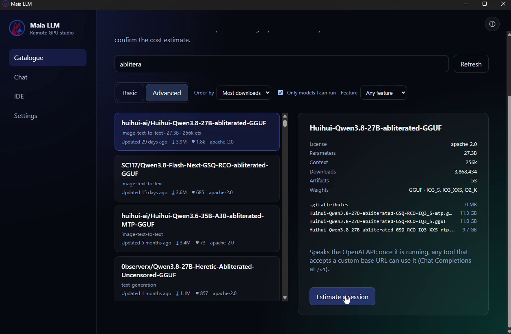

<p align="center">
  
</p>

<h1 align="center">Maia LLM</h1>

<p align="center">
  Run open-weight language models on a GPU you rent only for as long as you use it.
</p>

---

Maia LLM is a Windows desktop app for people who want to *use* open-weight
models, not operate a cluster. It turns "I want to try this model" into a few
clicks: browse the Hugging Face catalogue, see exactly what the run will cost
before anything is created, let Maia rent a matching GPU on vast.ai, chat in a
normal LLM interface, and release the GPU the moment you stop. No terminal, no
YAML, no forgotten instances burning credit.

Three ideas shape everything in the app:

1. **You see the price before the resource exists.** An estimate — GPU, hourly
   rate, minimum charge, expected total and a range — has to be confirmed before
   Maia provisions anything.
2. **Your GPU time is yours to control.** Several models can run in parallel, each
   with its own meter; stopping a model or closing the app releases the hardware.
3. **Your data stays yours.** Chats live in a local SQLite file, credentials live
   in the Windows credential vault, and no conversation content leaves the machine.

## What you get

- **A real catalogue** of open-weight models with license, size, context window,
  gated status, and feature filters (tool use, reasoning, vision, code, long
  context). Search hits the Hugging Face API; order by downloads, newest, likes, or
  size.
- **No surprise bills.** Every run starts with an estimate: GPU, hourly rate,
  minimum charge, expected total, and a range. Nothing is provisioned until you
  confirm it.
- **Automatic GPU rental** through vast.ai, chosen to fit the model and your
  optional GPU preferences (country, trusted machines, reliability, price cap).
  Maia retries startup on up to five replacement machines by default; adjust the
  retry count under Settings → GPU preferences. A shared reputation service
  records which machines actually start, so a broken host is skipped for every
  workspace instead of failing again — see
  [docs/gpu-reputation-api.md](docs/gpu-reputation-api.md).
- **Chat like a modern LLM app**: streaming answers, live "thinking" output,
  multiple models running in parallel, a model selector per conversation, and a
  chat history sidebar you can rename and pin.
- **Conversations that survive.** Stop a model and reopen the chat later — restart
  the same model or continue with another one, with a clear notice where the model
  changed.
- **A lifecycle log you can actually read.** Provisioning, boot, model download,
  "running", releases and errors are timestamped so you always know what the GPU
  is doing. Closing the app warns first and shuts the GPUs down; a detached
  guardian does the same if the app crashes or is force-quit — see
  [docs/gpu-lifecycle.md](docs/gpu-lifecycle.md).

### Optional extras

Both are off until you turn them on.

- **Archive models in your own S3 bucket.** Keep a copy of the open-weight models
  you use often — with checksums and a restore path — in storage you control
  (Amazon S3, Cloudflare R2, Backblaze B2, MinIO). Useful when a Hub revision
  disappears, a gated repo changes, or you simply do not want to re-download tens
  of gigabytes every session. Nothing is uploaded unless you pick a model and a
  destination.
- **Serve the running model locally to your editor and agents.** Maia can expose
  the active model on `127.0.0.1` through an **Ollama-compatible API**, so tools
  such as VS Code assistants, Continue, Cline or your own agents can call it like a
  local model. Loopback only (never reachable from the network), disabled by
  default, and it shuts down when the session ends.

## Demo

A short recorded walkthrough is being prepared: catalogue → estimate →
provisioning with the live log → first answer → release.

> 🎬 **`docs/demo/maia-llm-demo.mp4`** — 2-minute quick demo *(coming soon)*

What the recording covers, so it stays in sync with the app:

1. Search the catalogue and open a model; read the estimate.
2. Confirm it and watch the provisioning log through to *Running*.
3. Ask a question, show the streamed answer and the live cost meter.
4. Stop the model, then reopen the chat and continue it with another model.

<!--
Publishing the demo: drop `maia-llm-demo.mp4` (H.264/AAC, 1080p, < 20 MB) and a
`demo-poster.png` frame into `docs/demo/`, then replace the line above with:

<p align="center">
  <a href="docs/demo/maia-llm-demo.mp4">
    
  </a>
</p>

For GitHub, upload the video to a release asset or an issue attachment and link
that URL instead, because GitHub does not play repository-hosted video files.
-->

## Install

1. Open the [releases page](https://github.com/texano00/maia-llm/releases) and
   download `MaiaLLM-Setup-<version>-x64.exe`.
2. Run it. The installer is per-user (no administrator rights) and detects an
   existing installation: it asks once, then updates in place and keeps your
   chats and settings.
3. Optional: verify the download against `SHA256SUMS.txt` in the same release.

**About the Windows warning.** Builds are currently unsigned, so Windows may show
*"Windows protected your PC"* or, with Smart App Control enabled, *"part of this
app has been blocked"*. Use *More info → Run anyway*; the signature setup that
removes the warning entirely is described in
[docs/release-process.md](docs/release-process.md).

## First run

1. **Settings → vast.ai API key** — paste your key and press *Test connection*.
   Restart Maia LLM so it picks up the key. Without a key the app stays in
   simulation mode: the whole flow works, but no real GPU is rented.
2. **Settings → Hugging Face token** (optional) — needed only for gated models.
   For a gated model, open its Hugging Face page and accept the terms or request
   access before starting. Sign in there with the same account as the token saved
   in Maia; manual access requests must be approved by the repository owner.
3. **Settings → GPU preferences** (optional) — limit offers to countries,
   machines, a reliability floor or a price ceiling. The startup gates
   (1000 Mbps down, 200 Mbps up, 500 MB/s disk) are on by default: a cold start
   moves about 25 GB, so a slower host turns a two-minute boot into a ten-minute
   one. Clear a gate to disable it.
4. **Catalogue** — search a model, open it, press *Estimate a session*, review the
   price, then *Confirm and start session*.
5. The first run downloads and loads the model on the GPU, which can take 5–20
   minutes. The provisioning log shows each step with timestamps.
6. **Chat** — send messages, watch the live cost meter, rename or pin the
   conversation in the sidebar, and press *Pause and release GPU* when you are
   done.

Closing the app releases every running GPU.

## Updates

Maia LLM checks for a new version at startup and every 24 hours. When one exists,
a banner appears in the top-right corner: *Update now* downloads it, *Restart and
install* applies it and reopens the app. Nothing is downloaded without that click.

Beta builds are opt-in by launching the app with `MAIA_RELEASE_CHANNEL=beta`.

## Requirements

- Windows 10 or 11, x64
- A vast.ai account with an API key (and credit) for real GPU runs
- Internet access to huggingface.co and vast.ai
- Optional: an S3-compatible bucket if you want model backups
- Optional: an IDE assistant or agent that speaks the Ollama API

## Where things are stored

| Data | Location |
| --- | --- |
| Chats, settings, catalogue cache | `%APPDATA%\Maia LLM\maia.db` |
| Logs | `%APPDATA%\Maia LLM\logs\maia.log` |
| Provider credentials | Windows credential vault (`safeStorage`) |
| Model backups (optional) | Your own S3-compatible bucket |

## Build from source

```bash
npm install
npm run -w @maia/desktop dev          # desktop app, simulated GPU by default
MAIA_PROVIDER_MODE=live npm run -w @maia/desktop dev
```

Installers are built by GitHub Actions on a Windows runner:

```bash
gh workflow run windows-dev-build.yml --ref <branch> -f publish_release=true
```

More detail: [docs/development.md](docs/development.md) (setup, environment
variables, live log mirroring), [docs/troubleshooting.md](docs/troubleshooting.md)
(reading logs, diagnosing a stuck UI), [docs/release-process.md](docs/release-process.md)
(signing and release checklist).

## License

Proprietary. All rights reserved until a license is chosen.
