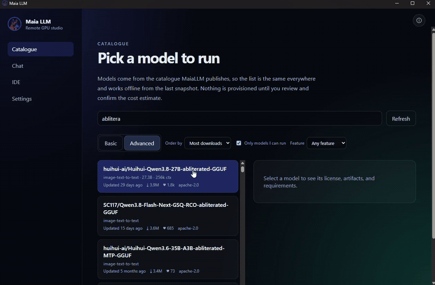

<p align="center">
  
</p>

<h1 align="center">Maia LLM</h1>

<p align="center">
  Run open-weight models on a GPU you rent for exactly as long as you use it —<br />
  then use them from your own editor, scripts and AI agents.
</p>

<p align="center">
  <strong>Free and fully open. No account, no email, no data selling.</strong><br />
  You bring your own provider keys and pay those providers directly. Maia LLM charges
  nothing, sells nothing, and keeps your conversations on your machine.
</p>

<p align="center">
  <sub>
    <a href="https://maiallm.com">maiallm.com</a>&nbsp;&nbsp;·&nbsp;&nbsp;Windows 10/11 x64&nbsp;&nbsp;·&nbsp;&nbsp;vLLM + llama.cpp&nbsp;&nbsp;·&nbsp;&nbsp;GGUF + safetensors&nbsp;&nbsp;·&nbsp;&nbsp;Ollama-compatible local API
  </sub>
</p>

---

Maia LLM is a Windows desktop app for people who want to *use* open-weight
models, not operate a cluster. It turns "I want to try this model" into a few
clicks: browse the catalogue, see exactly what the run will cost before anything
is created, let Maia rent a matching GPU on vast.ai, chat in a normal LLM
interface, and release the GPU the moment you stop. No terminal, no YAML, no
forgotten instances burning credit.

> **The model you rent is also a local API for your agents.** While a session
> runs, Maia serves it on `http://127.0.0.1:11434` as an **Ollama-compatible
> endpoint** — the same one Ollama itself uses. VS Code assistants (Continue,
> Cline), agent frameworks, RAG pipelines and your own scripts can then call the
> model as if it were installed locally: no API keys, no per-token billing, just
> the GPU you are already paying for by the hour. Loopback only, opt-in, and it
> stops when the session does — see
> [docs/ide-endpoint.md](docs/ide-endpoint.md).

```bash
# Settings → IDE endpoint → enable, start a session, then anything Ollama-shaped works
curl -s http://127.0.0.1:11434/api/tags
curl -s http://127.0.0.1:11434/api/chat -H 'content-type: application/json' \
  -d '{"model":"<the model you started>","stream":false,
       "messages":[{"role":"user","content":"Draft a commit message for this diff."}]}'
```

**Jump to:** [What you get](#what-you-get) · [Demo](#demo) ·
[Requirements](#requirements) · [Install](#install) · [First run](#first-run) ·
[Where things are stored](#where-things-are-stored) · [For developers](#for-developers)

Three ideas shape everything in the app:

1. **You see the price before the resource exists.** An estimate — GPU, hourly
   rate, minimum charge, expected total and a range — has to be confirmed before
   Maia provisions anything.
2. **Your GPU time is yours to control.** Several models can run in parallel, each
   with its own meter; stopping a model or closing the app releases the hardware.
3. **Your data stays yours.** Chats live in a local SQLite file, credentials live
   in the Windows credential vault, and no conversation content leaves the machine.

## What you get

- **Your agents get the model, locally.** A running session is exposed on
  `127.0.0.1:11434` through an Ollama-compatible API (`/api/tags`, `/api/chat`,
  `/api/generate`, streaming, thinking output), so token-hungry tools talk to the
  GPU you rent instead of a per-token provider. Edit your Continue/Cline config,
  or point a script at it — no SDK, no key. Off until you enable it.
- **A real catalogue** of open-weight models with license, size, context window,
  gated status, and feature filters (tool use, reasoning, vision, code, long
  context). Order by downloads, newest, likes, or size.
- **No surprise bills.** Every run starts with an estimate: GPU, hourly rate,
  minimum charge, expected total, and a range. Nothing is provisioned until you
  confirm it.
- **Automatic GPU rental** through vast.ai, chosen to fit the model and your
  optional GPU preferences (country, trusted machines, reliability, price cap).
  Maia retries startup on up to five replacement machines by default; adjust the
  retry count under Settings → GPU preferences. A shared reputation service
  records which machines actually start, so a broken host is skipped for every
  workspace instead of failing again — see
  [docs/gpu-reputation-api.md](docs/gpu-reputation-api.md).
- **Chat like a modern LLM app**: streaming answers rendered as Markdown —
  highlighted code with a copy button, tables, lists and links — a collapsible
  chat list, a transcript that does not yank you to the bottom while the model is
  writing, live "thinking" output, and a **student mode** that reveals the
  reasoning at a reading pace instead of dumping it. Multiple models can run in
  parallel, each conversation has its own model selector, and the history sidebar
  can rename and pin chats.
- **Conversations that survive.** Stop a model and reopen the chat later — restart
  the same model or continue with another one, with a clear notice where the model
  changed.
- **A lifecycle log you can actually read.** Provisioning, boot, model download,
  "running", releases and errors are timestamped so you always know what the GPU
  is doing. Closing the app warns first and shuts the GPUs down; a detached
  guardian does the same if the app crashes or is force-quit — see
  [docs/gpu-lifecycle.md](docs/gpu-lifecycle.md).

### Optional extras

Off until you turn it on.

- **Archive models in your own S3 bucket.** Keep a copy of the open-weight models
  you use often — with checksums and a restore path — in storage you control
  (Amazon S3, Cloudflare R2, Backblaze B2, MinIO). Useful when a Hub revision
  disappears, a gated repo changes, or you simply do not want to re-download tens
  of gigabytes every session. Nothing is uploaded unless you pick a model and a
  destination.

## Demo

<p align="center">
  <a href="docs/demo/maia-llm-demo.mp4">
    
  </a>
</p>

Fourteen seconds at 2× speed: pick a model and read the estimate, watch the
provisioning log move through image pull, download and load, then chat with the
model that just came up. Click the clip for the full-quality file.

## Requirements

- Windows 10 or 11, x64
- A vast.ai account with an API key (and credit) for real GPU runs
- Internet access to huggingface.co and vast.ai
- Optional: an S3-compatible bucket if you want model backups
- Optional: an IDE assistant or agent that speaks the Ollama API

## Install

1. Open **[maiallm.com](https://maiallm.com)** (or the
   [releases page](https://github.com/texano00/maia-llm/releases)) and download
   `MaiaLLM-Setup-<version>-x64.exe`.
2. Run it. The installer is per-user (no administrator rights) and detects an
   existing installation: it asks once, then updates in place and keeps your
   chats and settings.
3. Optional: verify the download against `SHA256SUMS.txt` in the same release.

**About the Windows warning.** Builds are currently unsigned, so Windows may show
*"Windows protected your PC"* or, with Smart App Control enabled, *"part of this
app has been blocked"*. Click *More info → Run anyway* to continue.

## First run

1. **Settings → vast.ai API key** — paste your key and press *Test connection*.
   Restart Maia LLM so it picks up the key. Without a key the app stays in
   simulation mode: the whole flow works, but no real GPU is rented.
2. **Settings → Hugging Face token** (optional) — needed only for gated models.
   For a gated model, open its Hugging Face page and accept the terms or request
   access before starting. Sign in there with the same account as the token saved
   in Maia; manual access requests must be approved by the repository owner.
3. **Settings → GPU preferences** (optional) — limit offers to countries,
   machines, a reliability floor or a price ceiling. The startup gates
   (1000 Mbps down, 200 Mbps up, 500 MB/s disk) are on by default: a cold start
   moves about 25 GB, so a slower host turns a two-minute boot into a ten-minute
   one. Clear a gate to disable it.
4. **Catalogue** — search a model, open it, press *Estimate a session*, review the
   price, then *Confirm and start session*.
5. The first run downloads and loads the model on the GPU, which can take 5–20
   minutes. The provisioning log shows each step with timestamps.
6. **Chat** — send messages, watch the live cost meter, rename or pin the
   conversation in the sidebar, and press *Pause and release GPU* when you are
   done.

Closing the app releases every running GPU.

## Updates

Maia LLM checks for a new version at startup and every 24 hours. When one exists,
a banner appears in the top-right corner: *Update now* downloads it, *Restart and
install* applies it and reopens the app. Nothing is downloaded without that click.

Beta builds are opt-in by launching the app with `MAIA_RELEASE_CHANNEL=beta`.

## Where things are stored

| Data | Location |
| --- | --- |
| Chats, settings, catalogue cache | `%APPDATA%\Maia LLM\maia.db` |
| Logs | `%APPDATA%\Maia LLM\logs\maia.log` |
| Provider credentials | Windows credential vault (`safeStorage`) |
| Model backups (optional) | Your own S3-compatible bucket |

## For developers

```bash
npm install
npm run -w @maia/desktop dev          # desktop app, simulated GPU by default
MAIA_PROVIDER_MODE=live npm run -w @maia/desktop dev
```

Installers are built by GitHub Actions on a Windows runner
(`windows-dev-build.yml`); lint, typecheck, tests and build run locally with
`npm run lint && npm run typecheck && npm test && npm run build`. See
[docs/development.md](docs/development.md) for setup, environment variables and
log mirroring, [docs/troubleshooting.md](docs/troubleshooting.md) for diagnosing
a stuck UI, and [docs/release-process.md](docs/release-process.md) for signing
and the release checklist.

## License

Proprietary. All rights reserved until a license is chosen.
