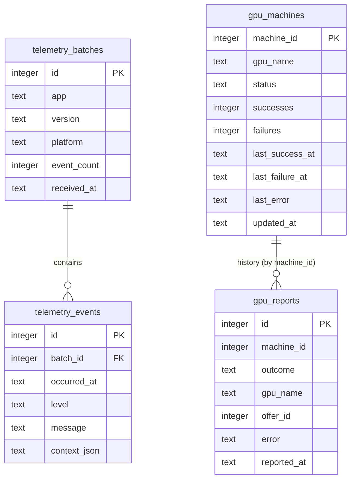

# Data storage

The telemetry API (`apps/portal`) stores three things: diagnostic batches sent
by the desktop app, the shared GPU reputation, and the start-up failures reported
by clients. All live in one SQLite database on the server.

```bash
npm run -w @maia/portal dev      # migrates and serves on :8787
```

| Variable                        | Default             | Purpose                                                               |
| ------------------------------- | ------------------- | --------------------------------------------------------------------- |
| `MAIA_DATABASE_FILE`            | `./var/maia.sqlite` | SQLite file (created, with its directory, on first boot)              |
| `MAIA_DB_DRIVER`                | `sqlite`            | Storage engine; `sqlite` is implemented, the port is ready for others |
| `MAIA_TELEMETRY_RETENTION_DAYS` | `30`                | Telemetry older than this is deleted on every ingest                  |
| `MAIA_UNSTABLE_TTL_HOURS`       | `6`                 | How long a failed GPU stays out of circulation                        |
| `MAIA_REPUTATION_FILE`          | unset               | Legacy JSON file, imported once and archived to `*.imported`          |

The driver is Node's built-in `node:sqlite` (Node 22.13+ / 23.4+), not a native
addon: the service installs with no compiler step, and the desktop app rebuilding
`better-sqlite3` for Electron's ABI cannot break it.

## Schema



Design rules that keep the schema portable:

| Concern            | Rule                                           | Why                                                     |
| ------------------ | ---------------------------------------------- | ------------------------------------------------------- |
| Timestamps         | ISO-8601 UTC `TEXT`                            | Sorts correctly and is unambiguous on every engine      |
| Booleans           | `INTEGER` 0/1                                  | SQLite has no boolean type; MySQL/PostgreSQL accept 1/0 |
| JSON               | `TEXT` column, parsed by the repository        | `jsonb`/`JSON` are not shared syntax                    |
| Surrogate keys     | One `autoId(dialect)` helper in the migration  | The only place SQLite, PostgreSQL and MySQL differ      |
| Counters and state | One row per machine, recomputed by the service | No dialect-specific upsert is needed                    |
| History            | Append-only `gpu_reports`                      | A counter reset cannot destroy evidence                 |

`GET /health` reports the active engine (`{"status":"ok","storage":"sqlite"}`), so
a deployment can be checked from outside.

## Layers

```
routes        Fastify handlers: parse, validate, shape the response
  ↓
services      domain rules: counters, freshness, retention
  ↓
repositories  SQL, expressed once for all dialects, `?` placeholders
  ↓
ports         SqlDatabase / SqlExecutor: async, driver-free interface
  ↓
adapters      src/db/sqlite.ts (node:sqlite)
```

- `src/db/database.ts` — the port plus helpers (`normaliseParams`,
  `toNumberedPlaceholders`) that adapters share.
- `src/db/sqlite.ts` — the only file that imports a driver. It serialises
  transactions (SQLite has a single connection) and sets WAL, foreign keys and a
  busy timeout.
- `src/db/migrate.ts` — applies migrations in one transaction each and records
  them in `schema_migrations`. The table is an ordinary one rather than SQLite's
  `user_version` pragma, so history survives an engine change.
- `src/repositories/*` — SQL, dialect-free. No service or route imports a driver.
- `src/services/*` — rules only; they take a repository, so they are tested with
  an in-memory database and an injected clock.
- `src/context.ts` — composition root: config → database → migrations →
  repositories → services.

## Adding a migration

1. Add `src/db/migrations/00N-name.ts` exporting a `Migration`.
2. Register it in `src/db/migrations/index.ts`; ids are applied in order and never
   reused.
3. Keep the statements ANSI: `TEXT`/`INTEGER`, `CREATE TABLE IF NOT EXISTS`,
   `CREATE INDEX IF NOT EXISTS`, `LIMIT ?`. No `ON CONFLICT`, no `AUTOINCREMENT`
   outside `autoId()`, no engine-specific functions.
4. Boot the service against a scratch file (`MAIA_DATABASE_FILE=/tmp/t.sqlite`) and
   check the migration applies and is idempotent on the second boot.

## Moving to PostgreSQL or MySQL

The SQL, the repositories, the services and the routes are already engine-neutral.
The work is confined to one new adapter and a short verification pass:

1. **Add the adapter** — implement `SqlDatabase` in `src/db/postgres.ts` with a
   pool (`SELECT`s via `query`, writes via `execute`, `transaction` using a
   dedicated client). Translate placeholders with
   `toNumberedPlaceholders(sql, "$")` (use `"?"` for MySQL, which keeps `?`).
   `normaliseParams` already converts booleans for engines that reject them.
2. **Select it** — in `src/config.ts` return the driver from `loadConfig()` and
   build the adapter in `src/context.ts`. `migrations` and every repository are
   used unchanged.
3. **Check the schema** — run the migrations against an empty database. Only
   `autoId()` needs a dialect branch; it already has `postgres` and `mysql`
   branches.
4. **Verify behaviour** — the suite is engine-agnostic. Point
   `createAppContext({ databaseFile })` at the new adapter and run
   `npx vitest run apps/portal`; the tests assert on ISO timestamps, monotonic
   history and retention, not on SQLite specifics.
5. **Copy the data** — export from SQLite (`sqlite3 maia.sqlite .dump` or a small
   script over the repositories) and import into the new engine. `id` columns are
   the only values worth preserving, because `machine_id` and timestamps carry the
   meaning.
6. **Keep the file** — SQLite remains the zero-dependency default for a single
   box. The port exists so a shared deployment can switch without a rewrite.

## Backup and inspection

- The database is a single file plus `-wal`/`-shm` sidecars. Copy all three, or
  stop the service first.
- `sqlite3 var/maia.sqlite 'select * from gpu_machines'` works from any shell.
- Telemetry can be read over HTTP: `GET /v1/diagnostics/logs?level=error&limit=50`.

## Opt-in usage samples (portal)

`usage_samples` holds one content-free measurement per finished model run, sent only
when the user turns usage reporting on. The desktop sends the model, capability,
output tokens, generation time, resulting tokens per second, the outcome, a
pseudonymous installation id, device facts (OS, version, architecture) and the
timestamp. It never sends prompts, responses, images, file paths or credentials.

- `POST /api/v0/usage` accepts one sample; unknown or content-like keys are
  rejected with `400` and nothing is stored.
- `POST /api/v0/usage/opt-in` and `/api/v0/usage/opt-out` record the preference in
  `usage_installations`; an opted-out installation receives `403 USAGE_OPTED_OUT`.
- `observed_address` stores the first `X-Forwarded-For` hop (or the socket address)
  in full and without expiry, per the product decision. Addresses never appear in
  application logs.
- Samples contain no content, so deleting a local conversation does not remove them.
- `MAIA_USAGE_ENABLED=false` turns the ingestion routes off entirely.

## Web app database (specs/005-web-access)

The product container keeps its own SQLite file at `MAIA_WEB_DATA/maia.db`
(`/data/maia.db` in the image) with the conversations, sessions, images metadata,
per-account settings and provider credentials of every account. It is separate
from the portal database above and never receives telemetry.

Account-scoped tables (`conversations`, `sessions`, `conversation_images`,
`credential_handles`, `credential_secrets`, `account_settings`) carry
`account_id`; deleting an `accounts` row cascades. Image bytes live under
`MAIA_WEB_DATA/images/<accountId>/`, next to the database, and are removed by the
service because a foreign key cannot delete files.

Provider keys are ciphertext in `credential_secrets` (AES-256-GCM, account id as
additional authenticated data). Without `MAIA_CREDENTIAL_KEY` a restored backup
cannot decrypt them. See [`web-access.md`](./web-access.md) for the full
operational checklist.
