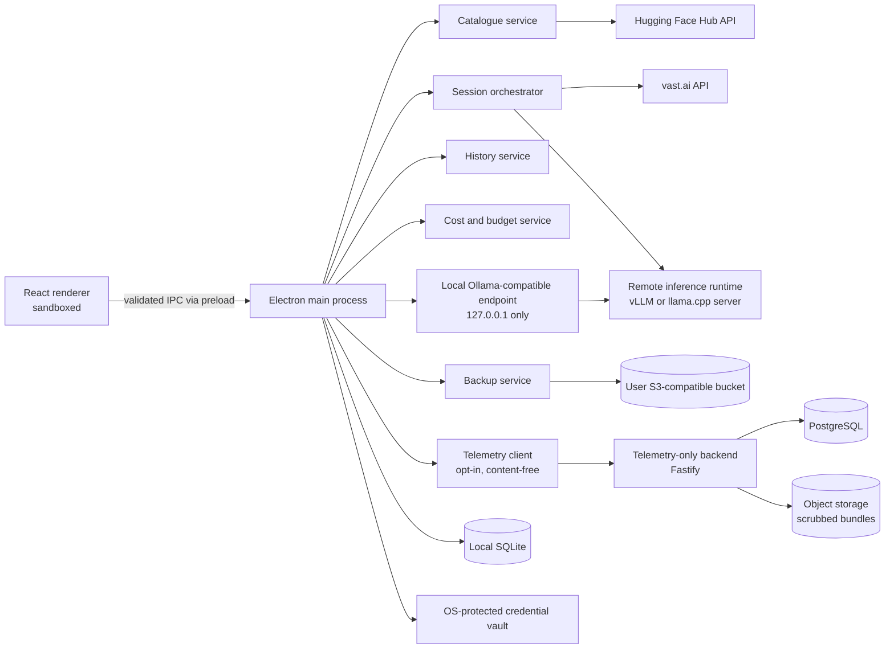

# Implementation Plan: Desktop LLM Suite with On-Demand Remote GPU and Model Archival

**Branch**: `001-desktop-llm-suite` | **Date**: 2026-11-02 | **Spec**: [spec.md](./spec.md)

**Input**: Feature specification from `/specs/001-desktop-llm-suite/spec.md`

## Summary

Build a Windows desktop application on Electron, React, and TypeScript that lets users browse the Hugging Face open-weight catalogue, start a session that automatically rents the required GPU on vast.ai, chat with the model, control spend, optionally expose the running model to local IDE assistants through a loopback Ollama-compatible endpoint, and archive model files to their own S3-compatible storage. A separate Fastify/TypeScript backend handles **only** opt-in telemetry: crash reports, diagnostic logs, app and OS metadata, and pseudonymized environment snapshots. It never proxies inference and never stores chat content or model artifacts.

Electron is chosen as the most widely adopted desktop framework that gives one codebase, a mature Windows installer and updater path, and first-class access to the Node.js ecosystem needed for streaming HTTP, S3 multipart uploads, and a local loopback server. Platform-specific behavior (paths, keychain, installers, GPU/process APIs) is isolated behind service adapters and packaging targets, so macOS and common Linux distributions can be added later without re-architecting the client.

GitHub Actions is the build and release system. Pull requests are gated by tests on a pinned Windows runner and a Linux runner, and a tag-driven release workflow produces a signed Windows installer, checksums, a CycloneDX SBOM, and a build-provenance attestation, then publishes them to a GitHub Release that doubles as the auto-update feed. The telemetry service is published to GHCR by image digest.

### Architecture at a Glance



## Technical Context

**Language/Version**: TypeScript 5.x in strict mode. Desktop: Node.js 22 LTS inside Electron's main process, React 19 in the renderer. Backend: Node.js 22 LTS. Exact versions pinned at implementation time.

**Primary Dependencies**: Electron (current stable) with electron-vite; React 19; Zustand; TanStack Query; Zod; better-sqlite3; Electron `safeStorage`; `@aws-sdk/client-s3`; pino; electron-updater; electron-builder. Backend: Fastify 5, Drizzle ORM with PostgreSQL 16, `postgres` driver, `@aws-sdk/client-s3`, rate limiting, and an OpenTelemetry-inspired ingestion envelope.

**Storage**: Desktop: SQLite in WAL mode for catalogue cache, conversations, messages, sessions, cost records, budgets, backup records, preferences, consent, and the telemetry outbox. Secrets live only in the OS-protected credential vault (DPAPI on Windows, Keychain on macOS, libsecret on Linux) and are referenced by opaque handles. Backend: PostgreSQL for installation profiles, event batches, crash metadata, and environment snapshots; S3-compatible object storage for scrubbed crash/log bundles with lifecycle rules.

**Testing**: Vitest for unit and integration tests; Playwright `_electron` for end-to-end desktop flows on Windows; contract tests with recorded fixtures for Hugging Face, vast.ai, S3, and the Ollama-compatible surface; Testcontainers (PostgreSQL, MinIO) for the backend. CI runs on GitHub Actions with a pinned `windows-2022` runner, adding `ubuntu-24.04` and `macos-14` runners when those targets become supported.

**CI/CD and Distribution**: GitHub Actions only. PR workflows run lint, typecheck, unit, contract, and mock-provider E2E tests; backend integration uses PostgreSQL and MinIO service containers. A tag-driven release workflow builds on a pinned `windows-2022` runner, signs the installer with Authenticode, generates SHA-256/SHA-512 checksums, a CycloneDX SBOM, and a provenance attestation, then publishes to a GitHub Release and the auto-update feed. Telemetry images go to GHCR by digest. Every publish step fails closed if tests, signing, or checksum verification fail.

**Target Platform**: Windows 10 and 11 x64 as the only shipping target in this release. Electron packaging targets for macOS 13+ (dmg, notarized) and Linux (deb, rpm, AppImage) are configured but not released; no service or renderer code may depend on Windows-only APIs.

**Project Type**: Desktop application plus a telemetry-only backend, organized as an npm-workspaces monorepo with two independently deployable applications.

**Performance Goals**: UI interactions acknowledged within 100 ms; cached catalogue search under 1 s for 10,000 models; first streamed token rendered as soon as received; idle resident memory under 500 MB; crash-free sessions at or above 99.5%; telemetry upload capped at 5% of available bandwidth.

**Constraints**: No conversation content, prompts, responses, credentials, API keys, absolute paths, or model files in telemetry; telemetry off until explicit consent; local IDE endpoint bound to loopback only; one active inference session per installation; no orphaned paid GPU instances; chat history usable offline; signed installers and signed auto-updates.

**Scale/Scope**: One user per installation. Telemetry backend sized for 10,000 monthly active installations, bursts of 100 events/s, and 90-day raw retention. Approximately 12 primary screens: catalogue, model detail, session setup, chat, history, usage, backup, restore, integration, settings, consent, diagnostics.

## Constitution Check

*GATE: Must pass before Phase 0 research. Re-check after Phase 1 design.*

**Constitution status**: Ratified **v1.0.0** on 2026-11-02. The project has six core principles, architectural/product constraints, and workflow gates that are now enforceable.

| Principle | Status | Evidence |
|-----------|--------|----------|
| I. Privacy and Local-First User Data (NON-NEGOTIABLE) | PASS | Conversation data stays in local SQLite; credentials use the OS vault; telemetry is opt-in, allowlisted, and content-free; the IDE endpoint is loopback-only and disabled by default. Enforced by `contracts/telemetry-ingestion-api.md`, `contracts/local-ollama-api.md`, and the telemetry allowlist gate. |
| II. Cost Transparency and Spend Safety (NON-NEGOTIABLE) | PASS (plan) | The estimate precedes provisioning; the session meter, hard caps, teardown, orphan reconciliation, receipts, and usage reporting are planned in Slices A and D. |
| III. Contract-First Provider Isolation | PASS | Hugging Face, vast.ai, S3, inference, IPC, Ollama-compatible, telemetry, and release boundaries each have a contract and shared Zod schemas in `packages/contracts`. |
| IV. Test-First for Critical Paths (NON-NEGOTIABLE) | PASS (plan) | Critical paths have unit, contract, integration, or E2E tasks; CI uses recorded fixtures and `MAIA_PROVIDER_MODE=mock`, never live GPU calls. |
| V. Cross-Platform Desktop Foundation | PASS | Electron plus platform adapters; Windows is the only shipping target; macOS/Linux packaging dry runs are required. |
| VI. Supply-Chain Integrity and Immutable Releases | PASS (plan) | Tag-driven release, Authenticode signing, SHA-256/SHA-512 checksums, SBOM, provenance, protected environment, fail-closed publication, and immutable assets. |

**Architectural and product constraints**: PASS — telemetry-only backend, single-user scope, one active session, offline history, bring-your-own provider accounts, text/chat models, USD costs, and Ollama-compatible IDE integration are all reflected in the structure and contracts.

**Workflow gates**: PASS (plan) — Spec Kit sequence, PR test gates, security review for sensitive changes, complexity justification, redacted logging, dependency audit, and protected release approval are specified in the plan and quickstart.

**Post-Design Re-Check (after Phase 1)**: Re-evaluated `research.md`, `data-model.md`, `contracts/`, and `quickstart.md` against the ratified constitution. No principle violations or unjustified constraints were found. `tasks.md` must be regenerated after this plan update so its story ordering matches the revised Slice A/Slice D boundary.

## Project Structure

### Documentation (this feature)

```text
specs/001-desktop-llm-suite/
├── plan.md              # This file (/speckit-plan command output)
├── research.md          # Phase 0 output (/speckit-plan command)
├── data-model.md        # Phase 1 output (/speckit-plan command)
├── quickstart.md        # Phase 1 output (/speckit-plan command)
├── contracts/           # Phase 1 output (/speckit-plan command)
└── tasks.md             # Phase 2 output (/speckit-tasks command - NOT created by /speckit-plan)
```

### Source Code (repository root)

```text
apps/
├── desktop/
│   ├── src/
│   │   ├── main/
│   │   │   ├── bootstrap/            # app lifecycle, single-instance lock, crash hooks
│   │   │   ├── ipc/                  # typed IPC handlers, Zod validation
│   │   │   ├── services/
│   │   │   │   ├── catalogue/        # HF search, detail, cache, gating
│   │   │   │   ├── sessions/         # orchestrator, state machine, reconciliation
│   │   │   │   ├── inference/        # runtime adapter, streaming, cancellation
│   │   │   │   ├── providers/
│   │   │   │   │   ├── huggingface/  # Hub API client
│   │   │   │   │   ├── vastai/       # offers, instances, teardown
│   │   │   │   │   └── s3/           # multipart, presign, verification
│   │   │   │   ├── history/          # conversations, search, export
│   │   │   │   ├── cost/             # estimates, meter, budgets, receipts
│   │   │   │   ├── backup/           # manifest, resume, restore
│   │   │   │   ├── local-endpoint/   # Ollama-compatible loopback server
│   │   │   │   ├── telemetry/        # consent, scrubbing, outbox, uploads
│   │   │   │   ├── credentials/      # vault handles
│   │   │   │   └── updates/          # signed auto-update
│   │   │   └── storage/              # SQLite connection, migrations, repositories
│   │   ├── preload/                  # contextBridge allowlist
│   │   └── renderer/
│   │       ├── app/                  # routing, layout, error boundaries
│   │       ├── features/
│   │       │   ├── catalogue/
│   │       │   ├── model-detail/
│   │       │   ├── session/
│   │       │   ├── chat/
│   │       │   ├── history/
│   │       │   ├── cost/
│   │       │   ├── backup/
│   │       │   ├── ide-integration/
│   │       │   ├── telemetry-consent/
│   │       │   └── settings/
│   │       └── shared/               # design system, hooks, formatters
│   ├── tests/
│   │   ├── unit/
│   │   ├── contract/
│   │   └── e2e/                      # Playwright Electron flows
│   ├── resources/                    # icons, installer assets
│   └── electron-builder.yml
├── telemetry-api/
│   ├── src/
│   │   ├── routes/                   # installations, events, crashes, bundles, deletion
│   │   ├── ingest/                   # schema validation, allowlist, rate limits
│   │   ├── services/                 # retention, pseudonymization, aggregation
│   │   ├── db/                       # Drizzle schema, migrations, repositories
│   │   └── jobs/                     # retention sweeps, deletion completion
│   ├── tests/
│   └── Dockerfile
packages/
├── contracts/                        # shared Zod schemas and generated types
└── shared/                           # pure utilities, no platform APIs
infra/
├── docker-compose.yml                # PostgreSQL, MinIO, telemetry-api
├── migrations/
└── dashboards/                       # operational queries and charts
.github/workflows/
├── desktop-ci.yml                   # PR and main: lint, typecheck, unit, contract, mock E2E
├── telemetry-ci.yml                 # PR and main: migrations, integration tests, image build
└── release.yml                      # tag/dispatch: verify, sign, attest, publish
scripts/
└── release/                         # version check, checksums, manifest, feed, verification
```

**Structure Decision**: npm-workspaces monorepo with two deployables: `apps/desktop` (Electron main, preload, renderer) and `apps/telemetry-api` (Fastify, the only server-side component). `packages/contracts` is the single source of truth for IPC, the Ollama-compatible HTTP surface, telemetry ingestion, and provider adapter payloads, preventing client/server drift. Main-process code is organized by domain service, renderer code by feature folder, and platform-specific code is confined to `providers/`, `credentials/`, `updates/`, and packaging configuration. `infra/` provides local parity for PostgreSQL and S3-compatible storage, while `.github/workflows/` and `scripts/release/` own CI, signing inputs, checksums, the release manifest, and feed generation.

## Complexity Tracking

> The Constitution Check reports no violations. The entries below record justified architectural complexity so reviewers can challenge it.

| Complexity | Why Needed | Principle(s) | Simpler Alternative Rejected Because |
|-----------|------------|--------------|-------------------------------------|
| Two deployables (desktop + telemetry API) | The backend must be independently scaled, retained, and audited, and must be structurally incapable of touching inference or chat data. | I, III | Embedding third-party analytics in the desktop client would give up data ownership, consent control, and retention guarantees; a single process cannot enforce the separation required by Principle I. |
| Dual inference runtime (vLLM for safetensors, llama.cpp server for GGUF) | The Hugging Face catalogue contains both weight formats, and GPU memory/quantization needs differ substantially between them. | II, III | A single runtime would exclude a large share of the catalogue or require server-side conversion, which adds cost, latency, and failure modes. |
| Electron as the desktop framework | It is the most widely used desktop framework, provides the Node.js runtime needed for streaming HTTP, S3 multipart uploads, and the loopback server, and ships mature Windows installers that extend to macOS/Linux. | V | Tauri would require implementing these services in Rust, shrinking the contributor pool; .NET MAUI and Flutter have weaker Node/provider SDK integration and less mature plugin coverage for the required capabilities. |
| SQLite for history plus a separate OS credential vault | Chat history must work offline, while API keys must never be stored alongside user data. | I | A single SQLite store for everything would put long-lived secrets in an unencrypted database file; a server-side history store violates the local-first principle and the no-content-upload assumption. |
| Recorded-fixture contract tests for external providers | Provider APIs change and CI must not rent GPUs or spend money on every build. | IV | Live provider calls in CI would be slow, flaky, and billable; no contract tests would allow silent drift in catalogue, provisioning, or backup behavior. |

## Delivery Slices

| Slice | Scope | Depends on |
|-------|-------|------------|
| A (P1) | Catalogue, session setup with pre-session estimate, basic receipt, vast.ai provisioning, runtime bootstrap, streaming chat, teardown | Foundation |
| B (P2) | Local conversation persistence, search, reopen, export, crash recovery | Slice A |
| C (P3) | Loopback Ollama-compatible endpoint, IDE configuration surface, idle-timeout integration | Slice A |
| D (P4) | Live cost meter, caps, monthly budget, receipt variance, usage views | Slice A |
| E (P5) | S3 backup, resume, verification, restore, backup catalogue | Slice A |
| F (cross-cutting) | Telemetry consent, scrubbing, outbox, telemetry API, retention and deletion | Foundation (can run in parallel) |
| G (release) | GitHub Actions CI, signed Windows artifacts, SBOM and provenance, GitHub Releases distribution, update feed | Foundation |

Constitution Principle II requires the pre-session estimate and basic receipt in Slice A; advanced spend controls remain in Slice D.

## Implementation Order

1. **Foundation**: npm-workspaces monorepo, Electron shell with `contextIsolation` and sandboxing, typed IPC contract, SQLite migrations, design system, CI pipelines, recorded-fixture harness.
2. **Catalogue**: Hugging Face adapter, cached catalogue, search/filter/sort, model detail, gating and license acceptance.
3. **Sessions and inference**: session state machine, pre-session estimator, basic receipt, vast.ai offer selection and provisioning, runtime image bootstrap, health checks, teardown, startup reconciliation, streaming adapter.
4. **History**: conversations and messages persistence, search, export, crash-safe writes, IDE-origin conversations.
5. **Cost control**: live meter, caps and budgets, receipt variance, usage reporting.
6. **IDE integration**: loopback server, Ollama-compatible endpoints, port-conflict handling, model naming, request accounting, idle-timeout extension.
7. **Backup and restore**: S3 adapter, manifest format, resumable multipart uploads, verification, restore-to-runnable flow, broken-record handling.
8. **Telemetry and release**: consent UX, payload allowlist and scrubber, outbox with retry, Fastify ingestion API, retention and deletion jobs, Windows signing, auto-update, and dormant macOS/Linux packaging targets.
9. **Distribution automation**: PR CI gates, tag-driven release workflow, code signing in a protected environment, checksums, SBOM, provenance attestation, GitHub Release publication, stable/beta update feeds, and artifact verification in CI.

## CI/CD and Distribution

GitHub Actions is the only build and release system. The repository already lives on GitHub, so release assets, provenance, and updater feeds can be served without an additional distribution service.

### Workflows

| Workflow | Trigger | Runner | Responsibilities |
|----------|---------|--------|------------------|
| `desktop-ci.yml` | Pull request, push to `main` | `windows-2022` | `npm ci`, lint, typecheck, unit tests, contract tests, Playwright E2E against recorded providers, renderer security checks. Uploads traces only on failure. |
| `telemetry-ci.yml` | Pull request, push to `main` | `ubuntu-24.04` | Migrations, integration tests against PostgreSQL 16 and MinIO service containers, container build, schema/allowlist tests. No registry push on PRs. |
| `release.yml` | Tag `v*`, manual `workflow_dispatch` | `windows-2022` + `ubuntu-24.04` | Re-runs all gates, builds and signs the Windows installer, builds the telemetry image, generates checksums, SBOM, provenance, release manifest, and publishes a GitHub Release and GHCR image. |

All workflows use `npm ci` with the committed lockfile, Node.js 22, and dependency caching keyed by the lockfile hash. Third-party actions are pinned to full commit SHAs.

### Release Flow

1. A maintainer bumps the version in `package.json` files, commits, and pushes a protected tag `vX.Y.Z` (or `vX.Y.Z-beta.N`).
2. `release.yml` verifies the tag matches the package version and that the commit is on `main`; it refuses to build otherwise.
3. The verify jobs re-run lint, typecheck, unit, contract, mock E2E, and backend integration tests. Any failure stops the release.
4. `build-desktop` builds the NSIS installer (and optional MSI) on `windows-2022`, signs it with Authenticode, computes SHA-256/SHA-512 checksums, generates a CycloneDX SBOM, and attests build provenance.
5. `build-telemetry` builds the container with Buildx, scans it, pushes to GHCR with a digest, and attests provenance.
6. `publish` waits for the protected `release` environment approval, creates a draft GitHub Release, uploads all assets, re-downloads them to verify checksums and signatures, writes `release-manifest.json`, and publishes stable or prerelease.
7. `electron-updater` reads the feed assets from the published release. Stable installations only see stable releases; beta is opt-in in Settings.
8. Rollback promotes a previous release back to the feed or marks the bad release as prerelease; artifacts are never rebuilt, so checksums remain valid.

### Release Artifact Set

| Asset | Purpose |
|-------|---------|
| `MaiaLLM-Setup-{version}-x64.exe` | Signed NSIS installer for Windows 10/11 x64 |
| `MaiaLLM-Setup-{version}-x64.exe.blockmap` | Differential update metadata |
| `MaiaLLM-{version}-x64.msi` | Optional enterprise MSI |
| `latest.yml` | Stable auto-update feed consumed by electron-updater |
| `latest-beta.yml` | Beta auto-update feed |
| `release-manifest.json` | Machine-readable release record (channel, min supported version, artifact hashes, feed location) |
| `SHA256SUMS.txt` | Human-verifiable checksums |
| `maia-llm-{version}-sbom.cdx.json` | CycloneDX software bill of materials |
| GitHub attestation | Build provenance verifiable with `gh attestation verify` |
| `ghcr.io/texano00/maia-llm-telemetry@sha256:…` | Telemetry service image pinned by digest |

### Versioning and Channels

- Semantic versioning. Release tags are `vMAJOR.MINOR.PATCH`; prereleases are `vMAJOR.MINOR.PATCH-beta.N`.
- `stable` is the default channel. `beta` is opt-in and receives prereleases only.
- `release-manifest.json` records `min_supported_version`; the app warns or blocks sessions only when the telemetry/API schema requires it, never to force an unrelated upgrade.
- The version appears identically in the app, installer metadata, `latest.yml`, `release-manifest.json`, and telemetry `app_version`; the release workflow fails on mismatch.
- macOS and Linux packaging targets are built in `--dir` dry-run mode to catch configuration drift, but are not published in v1.

### Security and Governance

- Default workflow permission is `contents: read`; the release job receives `contents: write`, `id-token: write` (provenance), and `packages: write` (GHCR) only where required.
- Signing certificate and password are stored as environment secrets in the protected `release` environment (`WINDOWS_CERT_PFX_BASE64`, `WINDOWS_CERT_PASSWORD`). They are never written to logs, artifacts, or caches.
- The `release` environment requires maintainer approval; tags matching `v*` are protected; only maintainers can dispatch the workflow.
- The publish job verifies the Authenticode signature and re-downloads every asset before announcing the release.
- No provider credentials or GPU rentals exist in CI; E2E tests run with `MAIA_PROVIDER_MODE=mock`.
- Dependabot monitors npm, GitHub Actions, and the base images; `npm audit` runs on every PR with high-severity failures blocking release.
- CI artifacts expire after 14 days; GitHub Release assets are retained permanently.

### Distribution to Users

- The GitHub Releases page is the download location and the update feed; no separate CDN or server is required in v1.
- Users download the signed installer and can verify it against `SHA256SUMS.txt` and the published attestation.
- Installed apps check the feed on startup and every 24 hours, download updates in the background, and install on restart after signature verification.
- The telemetry service is deployed from the digest-pinned GHCR image during a separate, approved operations run; the release workflow never deploys to production automatically.
- Future channels (winget, Chocolatey, Microsoft Store) can reuse the same signed artifacts without rebuilding.

## Phase 0 and Phase 1 Artifacts

- `research.md` — framework, runtime, provider, storage, privacy, packaging, and testing decisions with alternatives.
- `data-model.md` — local and backend entities, relationships, validation rules, and state machines.
- `contracts/` — desktop IPC, Ollama-compatible endpoint, telemetry ingestion, Hugging Face catalogue, vast.ai provisioning, S3 backup manifest, and release artifacts/update feed.
- `quickstart.md` — local setup, run and test commands, and end-to-end validation scenarios per user story, including the release pipeline. All design artifacts were re-validated against constitution v1.0.0.
